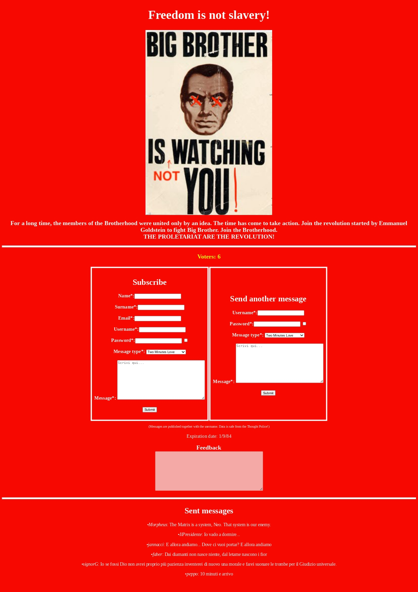

# FreedomIsNotSlavery

## Table of contents
- [About](#about)
- [Run the project](#run-the-project)
- [License](#license)

## About
FreedomIsNotSlavery is inspired by and pays homage to George Orwell’s book *1984*.
It imagines a scenario in which members of the Brotherhood decide to reunite after a long time and launch a revolution against the Party and Big Brother.
They create a website designed to gather support through two forms: one form is for user registration, where users are asked to enter their first name, last name, an email address for contact, a username to log in and post messages, a password, and a message to send; the other form is for already registered users, allowing them to send another
message by entering their username and password.
To encourage people to participate, the messages sent are published on the site along with the usernames, excluding other user information, in order to ensure their privacy.

You are a Thought Police agent and have been tasked with attacking the website to exfiltrate the revolutionaries’ data, uncover their identities, and stop the attempted revolution.

<p align="center">
  
</p>

> [!WARNING]  
> FreedomIsNotSlavery is a university project focused on creating a site on which test SQL injection. 
> The graphic design and security features are overlooked in order to focus on the rest.

## Run the project

> [!WARNING]  
> This project was developed in a GNU/Linux environment.

- Open the terminal.
- Navigate to the ‘website’ folder.
- Run the command. 
  ```bash
		docker compose up -d
		```
- Open the website in a browser tab using the address ‘localhost:8080’.
- Open the database:
    - Enter the address ‘localhost:8081’ in another browser tab.
	- Log in to PhpMyAdmin by entering:
        - Username: winston
        - Password: winston1984
    - Import the database file (‘finsDB.sql’) located in the ‘Database’ folder
- The project is ready, glhf : )

## License

*Copyright© 2026 Giuseppe Nardini Francesco Puliti Sara Marini*\
This program is licensed under the [AGPL-3.0](LICENSE) license.
